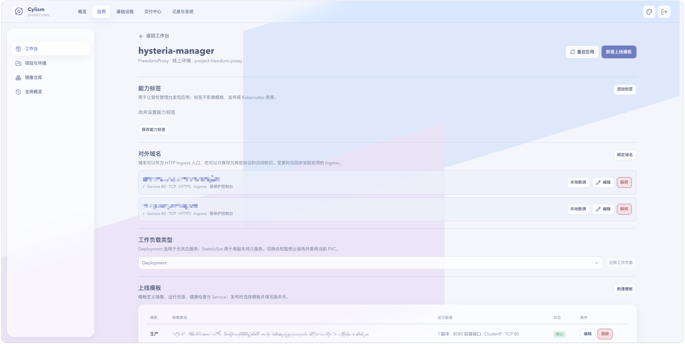

# 发布与版本记录

## 用途与边界

发布将应用的上线模板与版本号组合为镜像，并保存一次独立快照。后续修改模板、域名或依赖不会改写既有记录。

## 进入位置

从应用工作台点击“发布版本”，或在应用详情的发布记录中打开某次发布。

## 准备条件

应用需要至少一个已启用的上线模板。模板中的镜像路径、资源配置、健康检查、Service 和文件依赖应已校验；项目须已授权对应镜像仓库。

## 核心操作

1. 在应用详情创建或编辑上线模板，并设定默认模板。
2. 选择模板，填写符合规则的版本号，提交发布。
3. 在发布详情查看镜像、模板快照、执行状态与关联资源。
4. 发布失败时根据状态和事件修正配置后重新发起，不要将同一次失败记录视为可编辑任务。

## 部署配置与 DNS

模板编辑器按基础信息、服务部署、配置与存储、资源与健康、服务网络分区，每次只展示一个分区。切换分区保留未保存的输入，自定义启动方式和存储配置按需展开；保存时如有未填写的必填字段，会定位到对应分区。

“部署配置”优先展示上线模板；工作负载类型和能力标签统一从应用标题右侧的“应用设置”入口编辑，工作负载迁移需单独确认。自动发布回调的地址与 CI 请求格式可展开查看；运行依赖存在缺失时自动展开。

编辑上线模板，在“服务网络 → DNS 解析策略”中可选择：

- **使用集群默认值**：不设置 Pod 的 `dnsConfig`，保持原有行为。
- **优先查询完整域名（ndots=1）**：带点的域名优先直接查询。例如 `mysql.database.svc.cluster.local` 会先查询自身，减少追加搜索后缀的请求；短名称 `mysql` 仍先使用搜索后缀。

该设置不会更换 DNS 服务器，也无法修复节点网络或 CoreDNS 故障。使用跨命名空间服务时建议填写完整 Service 域名。

保存模板后，需要发布或在平台滚动重启应用才会生效；滚动重启使用当前模板并保留最近成功发布的镜像版本。普通发布和 CI 回调都会保留 DNS 设置，重试、回滚使用相应发布快照。Deployment 和 StatefulSet 均支持，宿主机网络仍使用集群 DNS。API 字段为可选整数 `dns_ndots`，有效范围为 0–15；省略或设为 `null` 可恢复集群默认值。

## 环境变量与配置文件

在上线模板的“配置与存储”中：

- **环境变量**：点击“添加变量”，填写名称和值，选择普通值或敏感值。普通值存入应用专属 ConfigMap，敏感值加密保存并在发布时生成应用专属 Secret。
- **配置文件**：点击“添加文件”，在同一处填写文件名称、内容和容器内文件路径。选择“编写敏感文件”可安全保存数据库连接串、私钥等内容，无需先去资源管理创建 Secret。也可引用已有 ConfigMap 或 Secret 的 Key。
- **更多设置**：按需开启“允许外部修改”。新建文件默认只挂载为文件；如应用还依赖同名环境变量，可勾选“同时注入环境变量”。已有模板保留原来的环境变量注入行为。

编辑时不会回显已保存的敏感内容，留空表示保留原值；修改敏感配置名称需要重新填写内容。已有资源引用不会复制资源内容。文件按目录投影，请使用独立配置目录（如 `/etc/app`），避免覆盖镜像中已有的文件。保存模板后发布或滚动重启应用，使配置生效。

## CI 自动发布回调

在应用详情的“部署配置”中，为当前应用生成自动发布密钥并复制回调地址。密钥仅显示一次；轮换密钥或关闭入口后，旧密钥立即失效。回调始终使用该应用已启用的默认上线模板，调用方只能指定镜像版本号，不能更换镜像仓库或模板。

CI 应在镜像推送完成后向 `POST /api/applications/{id}/deployments` 发送 JSON 请求体，例如 `{"version":"1.2.3"}`。请求头格式与平台自身的更新回调相同：

- `X-Cylism-Timestamp`：当前 Unix 秒时间戳，允许偏差 5 分钟。
- `X-Cylism-Nonce`：每次请求生成的 16 至 256 位随机字符串，不得重复使用。
- `X-Cylism-Signature`：用应用密钥计算 `HMAC-SHA256(timestamp + "." + nonce + "." + 原始请求体)`，编码为小写十六进制。

以下示例假设 CI 已将密钥保存为 `CYLISM_WEBHOOK_SECRET`，将回调地址保存为 `CYLISM_WEBHOOK_URL`：

```sh
body='{"version":"1.2.3"}'
timestamp=$(date +%s)
nonce=$(openssl rand -hex 16)
signature=$(printf '%s.%s.%s' "$timestamp" "$nonce" "$body" | openssl dgst -sha256 -hmac "$CYLISM_WEBHOOK_SECRET" -hex | awk '{print $NF}')
curl --fail-with-body -X POST "$CYLISM_WEBHOOK_URL" \
  -H 'Content-Type: application/json' \
  -H "X-Cylism-Timestamp: $timestamp" \
  -H "X-Cylism-Nonce: $nonce" \
  -H "X-Cylism-Signature: $signature" \
  --data-binary "$body"
```

成功时返回 HTTP 202 和新发布记录。相同 nonce 的请求会被拒绝；重新触发发布时需要生成新的时间戳和 nonce。发布进度在“发布记录”中查看。

<figure class="documentation-screenshot">
  
  <figcaption>应用详情：域名、工作负载类型和上线模板。正式的发布记录页面截图待后续补充。</figcaption>
</figure>

## 状态与风险

发布可能处于进行中、成功或失败。更换工作负载类型会短暂停止服务；镜像标签若被覆盖，历史版本名称仍在但实际镜像内容可能已改变，应使用不可变标签。

## 关联页面

[自托管制品库](../supply-chain/managed-registry.md)和 [Registry Proxy](../supply-chain/registry-proxy.md)说明镜像来源；[应用工作台](application-workspace.md)显示最近发布。
