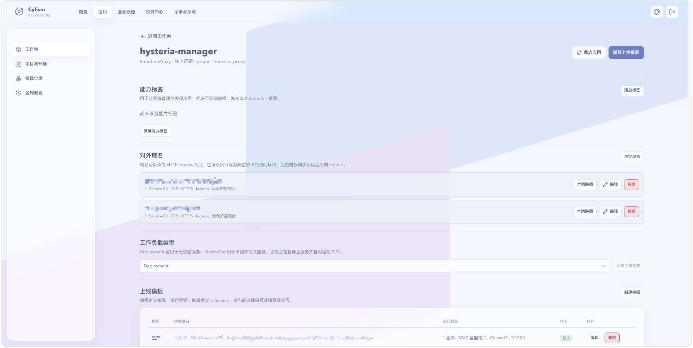

# 发布与版本记录

## 用途与边界

发布将应用的上线模板与版本号组合为镜像，并保存一次独立快照。后续修改模板、域名或依赖不会改写既有记录。

## 进入位置

从应用工作台点击“发布版本”，或在应用详情的发布记录中打开某次发布。

## 准备条件

应用需要至少一个已启用的上线模板。模板中的镜像路径、资源配置、健康检查、Service 和文件依赖应已校验；项目须已授权对应镜像仓库。

## 核心操作

1. 在应用详情创建或编辑上线模板，并设定默认模板。
2. 选择模板，填写符合规则的版本号，提交发布。
3. 在发布详情查看镜像、模板快照、执行状态与关联资源。
4. 发布失败时根据状态和事件修正配置后重新发起，不要将同一次失败记录视为可编辑任务。

## 部署配置与 DNS

模板编辑器按基础信息、服务部署、配置与存储、资源与健康、数据库迁移、服务网络分区，每次只展示一个分区。切换分区保留未保存的输入，自定义启动方式和存储配置按需展开；保存时如有未填写的必填字段，会定位到对应分区。

“部署配置”优先展示上线模板；工作负载类型和能力标签统一从应用标题右侧的“应用设置”入口编辑，工作负载迁移需单独确认。自动发布回调的地址与 CI 请求格式可展开查看；运行依赖存在缺失时自动展开。

编辑上线模板，在“服务网络 → DNS 解析策略”中可选择：

- **使用集群默认值**：不设置 Pod 的 `dnsConfig`，保持原有行为。
- **优先查询完整域名（ndots=1）**：带点的域名优先直接查询。例如 `mysql.database.svc.cluster.local` 会先查询自身，减少追加搜索后缀的请求；短名称 `mysql` 仍先使用搜索后缀。

该设置不会更换 DNS 服务器，也无法修复节点网络或 CoreDNS 故障。使用跨命名空间服务时建议填写完整 Service 域名。

保存模板后，需要发布或在平台滚动重启应用才会生效；滚动重启使用当前模板并保留最近成功发布的镜像版本。普通发布和 CI 回调都会保留 DNS 设置，重试、回滚使用相应发布快照。Deployment 和 StatefulSet 均支持，宿主机网络仍使用集群 DNS。API 字段为可选整数 `dns_ndots`，有效范围为 0–15；省略或设为 `null` 可恢复集群默认值。

## 环境变量与配置文件

在上线模板的“配置与存储”中：

- **环境变量**：点击“添加变量”，填写名称和值，选择普通值或敏感值。普通值存入应用专属 ConfigMap，敏感值加密保存并在发布时生成应用专属 Secret。
- **配置文件**：点击“添加文件”，在同一处填写文件名称、内容和容器内文件路径。选择“编写敏感文件”可安全保存数据库连接串、私钥等内容，无需先去资源管理创建 Secret。也可引用已有 ConfigMap 或 Secret 的 Key。
- **更多设置**：按需开启“允许外部修改”。新建文件默认只挂载为文件；如应用还依赖同名环境变量，可勾选“同时注入环境变量”。已有模板保留原来的环境变量注入行为。

模板列表不会返回已保存的敏感内容，留空表示保留原值；修改敏感配置名称需要重新填写内容。已保存的应用敏感文件支持以下编辑方式：

- **逐项编辑 env**：自动读取标准单行 `KEY=value` 配置。普通 ConfigMap 文件展开即显示内容。Secret 文件仅展示配置项名称，所有值默认隐藏，不再按名称猜测敏感性；点击某项的眼睛按钮后只读取该项的值，再次点击隐藏，未修改的已读取值会从页面状态清除。逐项查看必须成功记录审计，响应禁止缓存，审计不包含值。输入新值才替换对应项，显式清空表示空字符串；未修改的敏感值、原始行、引号及注释由后端保留。可新增、移除或恢复配置项。重复键、多行值或不支持的语法需使用全文编辑，不会强行转换。
- **查看并编辑全文**：主动确认后，使用当前平台管理账号读取文件完整内容，可编辑 YAML、JSON 或私钥等文件。读取必须成功记录审计，响应禁用缓存；审计仅记录操作者、模板、文件名和读取方式，不包含文件内容。普通模板接口不提供明文；外部集成仅能通过独立授权的通用文件接口读取明确开放外部管理的文件，见下文。未改动的全文在隐藏时清除，已修改的草稿可撤销；关闭模板编辑器清除页面中的明文与草稿。
- **并发保护**：逐项修改携带模板版本和原始行标识，由后端合并后加密保存；版本冲突时需要重新打开模板，不会覆盖其他人的修改。同一文件不能同时提交逐项修改与全文替换。

已有资源引用不会复制资源内容。文件按目录投影，请使用独立配置目录（如 `/etc/app`），避免覆盖镜像中已有的文件。保存模板后发布或滚动重启应用，使配置生效。

## 外部集成的通用配置接口

平台不解析代理协议、认证用户、UUID 或 REALITY。外部管理应用自行解析配置并提交完整文件，平台负责应用授权、挂载与外部管理开关、模板版本检查、加密保存和重新发布。

| 方法与路径（前缀 /api/integrations/applications/{id}） | 用途 | action |
| --- | --- | --- |
| GET /config-files | 列出默认模板中已挂载、已启用且允许外部管理的文件元数据 | application:read，并按对应来源的读取权限过滤 |
| GET /config-files/{source}/{key} | 读取一个受管文件的完整内容 | configmap:read 或 secret:read |
| PUT /config-files/{source}/{key} | 原子替换单个文件 | configmap:write 或 secret:write |
| GET /network | 查询模板宿主机网络、指定节点和解析出的公网地址 | application:read |

source 为 configmap 或 secret。更新请求为 {"content":"文件全文","expected_revision":3,"restart":true}，返回 template_revision 和可选的 release_id。版本冲突返回 409；restart 还要求 application:restart。Secret 内容不可为空，空 ConfigMap 内容允许。更新其他文件、关闭外部管理开关也会使旧版本失效，调用方须重新读取，不可自动覆盖。

Secret 只有显式挂载、已启用且允许外部管理的键可读写。读取的是选中文件全文：若文件包含服务私钥，该外部服务也会在内存中接触私钥；授权前应确保该管理服务可信。其他未开放的 Secret 不会返回。内容读取必须成功记录审计才返回，响应 no-store，审计只包含文件标识和模板版本。Secret 继续写入已有密文列，无新增数据表。

network.public_host 只为明确指定节点的 hostNetwork 模板解析公网 IP，依次选择节点 ExternalIP、同集群同节点服务器记录中的公网 Host、节点公网 InternalIP；拒绝共享地址段 100.64.0.0/10 和私网。无法确定时返回空字符串，由调用方结合已有入口、Service / LoadBalancer 判断可访问端点。

迁移时必须同时更新平台与调用方，旧 /hysteria/*、/vless/* 专属路由已移除。旧 ConfigMap 通用路由继续保留。重新从平台打开管理台以获得 secret:read / secret:write 授权，旧管理会话不会自动扩大权限。

## 发布前数据库迁移（MySQL）

在“部署配置 → 编辑上线模板 → 数据库迁移”启用迁移，填写镜像内命令、SQL 目录、数据库变量前缀和超时（30–3600 秒）。默认使用 `/usr/local/bin/cylism-migrate`、`/app/migrations`、`DATABASE` 和 600 秒。配置保存于现有模板 JSON，目标保存于发布快照；平台自身 SQLite 无需手工建表。

启用后，每次手动发布和 CI 回调都必须声明 `migration.target`。没有新 SQL 时也声明镜像所需的当前目标，工具核实记录后不会重复执行。未启用迁移的模板保持原有发布方式，回调不能临时开启迁移。

### 镜像与脚本

应用镜像需要包含迁移工具和完整历史 SQL。可在本仓库构建与应用镜像架构一致的二进制，例如 Linux amd64：

```sh
CGO_ENABLED=0 GOOS=linux GOARCH=amd64 go build -trimpath -o cylism-migrate ./cmd/cylism-migrate
```

在应用 Dockerfile 的最终阶段加入：

```dockerfile
COPY --chmod=0555 cylism-migrate /usr/local/bin/cylism-migrate
COPY migrations/ /app/migrations/
```

平台自身镜像也在 `/usr/local/bin/cylism-migrate` 提供该工具。脚本文件按正整数版本排序：

```text
migrations/
  202611220001_create_orders.sql
  202611220002_add_order_status.sql
  target
```

`target` 是供 CI 读取的普通文本文件，内容如 `202611220002`，工具只读取 `.sql`。版本最多 32 位；同一数字的不同写法（如 1 和 01）也不能重复。单个 SQL 文件最多 16 MiB，目录总计最多 64 MiB，拒绝符号链接。已上线脚本不可修改或删除，应以新增版本修正。脚本可包含多条普通 SQL；不支持 `DELIMITER` 等 mysql CLI 指令。不得切换数据库、修改迁移记录表或连接锁、改变会话事务状态。

### 数据库配置

在“配置与存储”提供环境变量（示例前缀 DATABASE）：

- `DATABASE_HOST`、`DATABASE_NAME`、`DATABASE_USER`：必填。
- `DATABASE_PORT`：可选，默认 3306。
- `DATABASE_PASSWORD`：必填，使用敏感变量，沿用既有加密存储和 Kubernetes Secret。
- `DATABASE_TLS`：可选，只接受 `true` 或省略；启用后使用系统信任根验证服务器证书。

这些键不能设为“仅文件”。账号需要目标库、迁移记录表及脚本涉及对象的操作权限。平台不从回调接收连接串、密码或 SQL；`CYLISM_MIGRATION_*` 是保留变量。

### 执行与恢复

发布顺序为：镜像检查 → 资源预检 → 数据库迁移 Job → 更新应用 → 等待就绪。Job 使用本次发布相同镜像及节点、网络、资源设置，使用独立 ConfigMap/Secret，不提前修改运行中应用的配置，不挂载应用 PVC，不自动重启失败容器。结束 7 天后由 Kubernetes 清理 Job 及其专属配置。

发布详情展示目标、执行步骤和最多 16 KiB 日志，模板敏感值会被遮蔽。自定义命令是受信任执行入口，应避免主动输出凭据，并自行遵循 `CYLISM_MIGRATION_TARGET`、`CYLISM_MIGRATION_DIR`、`CYLISM_MIGRATION_DATABASE_PREFIX` 环境变量。校验和、锁和 dirty 机制由内置工具提供，不会自动强加给其他工具。

内置工具在目标 MySQL 库创建 `_cylism_schema_migrations`，保存版本、文件名、SHA-256、dirty 和开始/完成时间。同库迁移以连接锁互斥。先校验完整已应用历史，再执行尚未完成的 SQL；历史缺失、校验和变化、倒序补脚本、目标不存在和数据库版本高于目标均中止。同一应用的迁移发布不能被其他发布越过；旧迁移 Job 未结束时拒绝新迁移任务。

MySQL DDL 可能部分生效，执行前会先持久保存 dirty。SQL 失败或中断后不会自动清除 dirty，也不会盲目重跑。维护者应检查日志、实际结构和记录表，在备份与明确执行进度的前提下修复到一致状态并确认记录，再重试发布。不要仅删除 dirty 记录来绕过保护。

重试创建新发布，使用原镜像、目标和配置快照，并从原模板恢复需要的当前密钥；密钥丢失会在创建前报错。平台重启导致中断的迁移发布会标记失败并记录原因，不自动重放 SQL；核实旧 Job 已结束后显式重试。

应用回滚与滚动重启不执行数据库迁移，也不撤销 SQL。迁移应向后兼容，以便旧应用仍可运行；删除列等不兼容变更应分阶段完成。备份和数据库恢复单独安排。

## CI 自动发布回调

在应用详情的“部署配置”中，为当前应用生成自动发布密钥并复制回调地址。密钥仅显示一次；轮换密钥或关闭入口后，旧密钥立即失效。回调始终使用已启用的默认模板；调用方可指定镜像版本和已启用迁移的目标，不能更换镜像仓库、模板、数据库连接或命令。

CI 应在镜像推送完成后向 `POST /api/applications/{id}/deployments` 发送 JSON 请求体，例如 `{"version":"1.2.3"}`。请求头格式与平台自身的更新回调相同：

- `X-Cylism-Timestamp`：当前 Unix 秒时间戳，允许偏差 5 分钟。
- `X-Cylism-Nonce`：每次请求生成的 16 至 256 位随机字符串，不得重复使用。
- `X-Cylism-Signature`：用应用密钥计算 `HMAC-SHA256(timestamp + "." + nonce + "." + 原始请求体)`，编码为小写十六进制。

以下示例假设 CI 已将密钥保存为 `CYLISM_WEBHOOK_SECRET`，将回调地址保存为 `CYLISM_WEBHOOK_URL`：

```sh
body='{"version":"1.2.3"}'
timestamp=$(date +%s)
nonce=$(openssl rand -hex 16)
signature=$(printf '%s.%s.%s' "$timestamp" "$nonce" "$body" | openssl dgst -sha256 -hmac "$CYLISM_WEBHOOK_SECRET" -hex | awk '{print $NF}')
curl --fail-with-body -X POST "$CYLISM_WEBHOOK_URL" \
  -H 'Content-Type: application/json' \
  -H "X-Cylism-Timestamp: $timestamp" \
  -H "X-Cylism-Nonce: $nonce" \
  -H "X-Cylism-Signature: $signature" \
  --data-binary "$body"
```

启用迁移时，从与镜像相同提交中的声明文件读取目标，在计算签名前构造完整请求体，例如：

```sh
version='1.2.3'
target=$(tr -d '\r\n' < migrations/target)
body=$(jq -cn --arg version "$version" --arg target "$target" '{version:$version,migration:{target:$target}}')
# 对这个 body 计算签名，并按前述示例原样发送。
```

请求体示例：`{"version":"1.2.3","migration":{"target":"202611220002"}}`。目标必须为字符串。缺少目标、目标无效或额外提供执行命令/数据库参数均拒绝。预检只校验配置，不连接业务库或执行 SQL；SQL 校验在迁移 Job 中完成。

成功时返回 HTTP 202 和新发布记录，表示接受任务，不代表迁移或应用已成功。相同 nonce 的请求会被拒绝；重新触发需要新的时间戳和 nonce。发布进度在“发布记录”中查看。

<figure class="documentation-screenshot">
  
  <figcaption>应用详情：域名、工作负载类型和上线模板。正式的发布记录页面截图待后续补充。</figcaption>
</figure>

## 状态与风险

发布可能处于进行中、成功或失败。更换工作负载类型会短暂停止服务；镜像标签若被覆盖，历史版本名称仍在但实际镜像内容可能已改变，应使用不可变标签。

## 关联页面

[自托管制品库](../supply-chain/managed-registry.md)和 [Registry Proxy](../supply-chain/registry-proxy.md)说明镜像来源；[应用工作台](application-workspace.md)显示最近发布。
