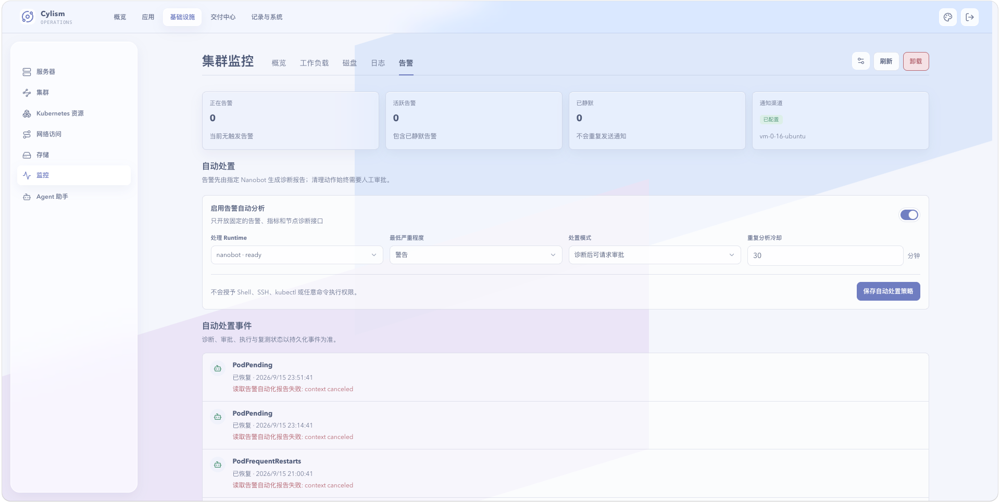

# 集群监控：告警

## 用途与边界

告警工作区管理规则评估、通知、静默及当前告警。可选的自动分析会生成诊断报告；清理或修复动作仍需要人工审批。

## 进入位置

进入“基础设施”后选择“监控”，打开“告警”标签页。

## 准备条件

VictoriaMetrics 与告警组件需可用。启用通知前准备飞书机器人或 SMTP 配置，并选择合适的告警节点。

跨集群通知使用平台的 `server.public_url`（环境变量 `PUBLIC_URL`）生成当前集群专属的回调地址。该地址需能从告警 Pod 访问；回调使用该集群 Secret 中的独立令牌认证，平台可部署在集群外。升级前已安装告警的集群，打开“告警设置”并保存一次即可更新回调地址，无需重新安装。

“测试飞书通知”和“测试邮件通知”验证平台到通知渠道的发送能力；完整回调链路需通过实际告警验证。

## 核心操作

1. 安装告警组件，等待规则和 Alertmanager 就绪。
2. 配置通知渠道与合并频率，保存后验证配置状态。
3. 查看正在告警和最近恢复，按严重程度进入关联资源。
4. 对计划维护创建带说明的有限时长静默；需要时启用只读自动分析。

## 历史告警与频次

告警页下方的“告警记录”支持“历史告警”和“频次统计”，可按节点名称（精确匹配）、告警类型、状态及最近 24 小时、7 天、30 天筛选，并分页查看。频次按节点与告警类型分组，按触发次数降序排列；查找 cloudcone 的高频告警时，输入实际节点名称并切换到“频次统计”。

平台将收到的告警回调保存在数据库中，并按集群隔离。相同指纹和开始时间的重试、重复通知及恢复回调更新同一条记录；再次触发且开始时间不同则计为新的一次。时间范围按开始时间计算。“待恢复”表示平台尚未收到恢复回调，实时状态以“正在告警”为准。历史查询不依赖集群当前在线状态。

历史从升级后收到的回调开始累计。此前自动分析用的 `AlertEvent` 只保留每个指纹的最新状态，旧版多集群回调也未写入该表，因此不能还原早期的完整触发次数。统计仅涵盖收到的回调，Alertmanager 静默或抑制期间未发送的回调不会计入；平台屏蔽规则命中的告警仍会保存并计入统计。测试通知不写入历史。

## 通知屏蔽规则

在“告警记录 → 屏蔽规则”中新增、编辑、启用、停用或删除规则。也可从历史告警或频次统计点击“屏蔽此类”，自动预填节点和类型。例如节点填 `cloudcone`，勾选 CPU 和内存过高，选择“长期”，即可持续屏蔽该节点这两类告警的飞书及邮件通知。

节点名称精确匹配。指定节点并多选类型时，节点必须匹配且类型满足其中任一种；节点留空表示当前集群全部节点，选择“该节点全部类型”表示只按指定节点匹配。规则不能同时匹配全部节点和全部类型。有效期支持 1 小时、4 小时、24 小时、7 天、30 天及长期，编辑默认保留原到期时间，重新选择有效期才会从保存时重新计时。过期规则需编辑有效期后才会重新生效。

规则保存在平台数据库，按集群隔离，Agent 离线时也能管理。规则在平台收到回调时生效，停止对应的触发和恢复通知；实时告警、历史、频次及自动处置照常运行。历史中的“最近回调已屏蔽”表示最近一次回调的通知被平台规则过滤。停用、删除或到期后，从下一次 Alertmanager 回调恢复通知，不补发过去的通知。原“正在告警”里的临时静默仍由 Alertmanager 管理，两者独立。

<figure class="documentation-screenshot">
  
  <figcaption>集群监控：告警标签页展示当前告警、通知状态和自动分析配置。</figcaption>
</figure>

## 状态与风险

静默只抑制通知，不解决故障；过宽的匹配条件会掩盖其他问题。自动分析只能使用受限诊断接口，任何实际处置应审核报告、确认影响范围后再批准。

## 关联页面

[指标监控](metrics.md)帮助判断根因；[Agent 助手](../automation/agent-assistant.md)说明受控自动化边界。
