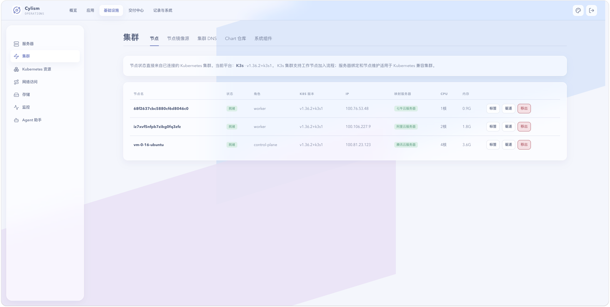

# 集群

## 用途与边界

本页用于查看集群连接、节点状态及平台管理的系统组件。它关注集群基础能力，不用于替代工作负载级故障分析。

## 进入位置

进入“集群”，在概览、节点和系统组件标签页间切换。

## 准备条件

集群凭据和 API 连通性必须正常；对组件进行安装、升级或卸载前，确认兼容版本、节点资源与维护窗口。

## 核心操作

1. 查看控制面、节点和集群连接状态。
2. 进入系统组件，检查安装状态、版本和就绪情况。
3. 根据组件引导完成安装或更新，并观察相关 Pod 变更。
4. 节点异常时先确认网络、磁盘和容器运行时，再继续处理。

## 移出工作节点

进入“集群 → 选择集群 → 拓扑”，在目标工作节点上点击“移出集群”。第一版支持已纳管、使用 systemd 和 K3s 自带 containerd 的工作节点，控制平面不提供此操作。集群 Agent 必须可用，服务器需要有效的 SSH 凭据和必要的 sudo 权限。

1. 先使用现有域名、入口和应用管理页面，将指向该节点的外部流量及需要迁移的服务切走；移出操作不会自动更改 DNS 或应用配置。
2. 在弹窗查看 Pod 分类。未受控制器管理的 Pod 会阻塞；包含 emptyDir 的 Pod 需要显式同意丢弃临时数据。DaemonSet、静态和已完成的 Pod 不参与驱逐，但节点停用后，其上仍在运行的容器也会停止。
3. 输入完整节点名确认。平台先标记不可调度，通过 Eviction API 排空，并等待 Pod 真正离开；遵守 PodDisruptionBudget，不强制删除 Pod。排空最多等待 10 分钟，期间新增阻塞项也会中止后续停机。
4. 平台核对节点 UID 和主机 machine-id，停止并禁用 k3s-agent，停止残留 K3s 容器；若配置了 Tailscale，仅撤销该节点 Pod 网段的广告路由，保留其他网段、出口节点设置及 Tailscale 连接。
5. 确认节点不再 Ready 后，按预期 UID 删除 Kubernetes Node，再以事务解除服务器与此集群的关联。本地 K3s 数据、服务器记录和 SSH 凭据保留，不运行卸载脚本。

提交后自动进入“集群任务”，可查看状态和分阶段日志；审计中记录发起用户及执行结果。失败时保留关联，已经完成的排空或停用不会自动回滚。处理原因后，可从拓扑或失败任务的“重新检查”入口重试。API 重启会将中断任务标记为失败；若节点对象已不存在，只有保存过主机停用检查结果的任务才允许继续核对并解绑。同名节点重新注册后 UID 变化会阻止重试，需要先核对服务器绑定。

“移出集群”与“卸载”含义不同：前者保留本地数据，后者执行原有 K3s 官方卸载脚本并删除本地集群数据。

<figure class="documentation-screenshot">
  
  <figcaption>集群：节点标签页展示节点状态、角色、版本和映射服务器；同一页面还提供节点镜像源、集群 DNS、Chart 仓库和系统组件标签页。</figcaption>
</figure>

## 状态与风险

组件显示就绪不保证业务请求无误。升级基础组件可能影响全局调度、网络或可观测性，应先阅读发布说明、固定版本并在变更后复测关键服务。

## 关联页面

[Kubernetes 资源](kubernetes-resources.md)查看业务资源；[指标监控](../operations/metrics.md)观察组件影响。
